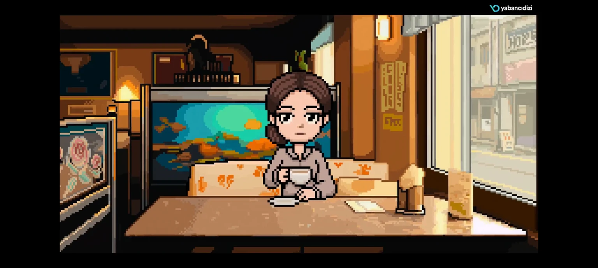
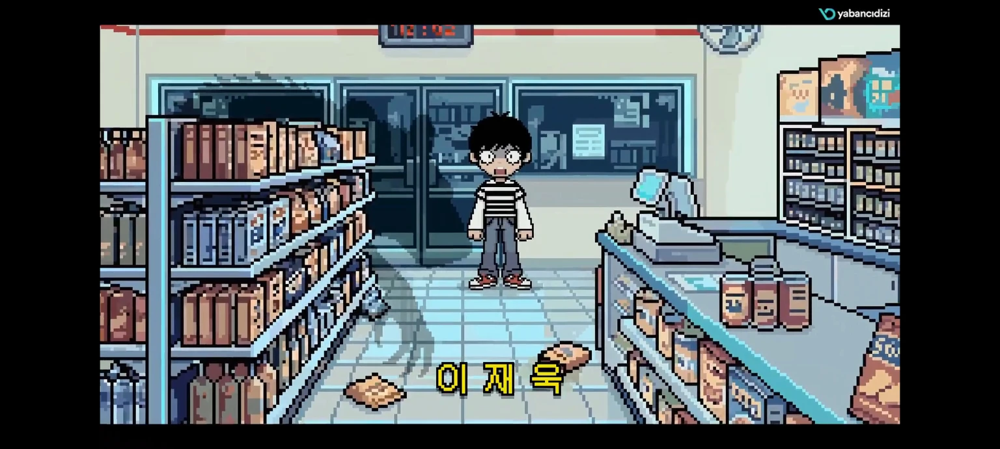
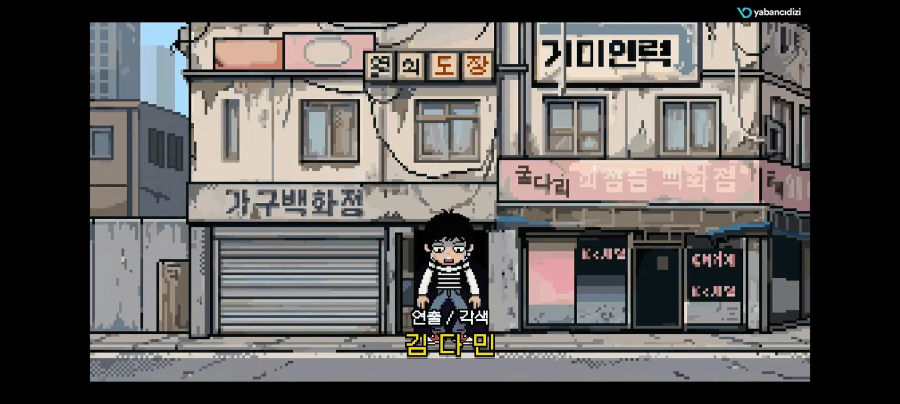
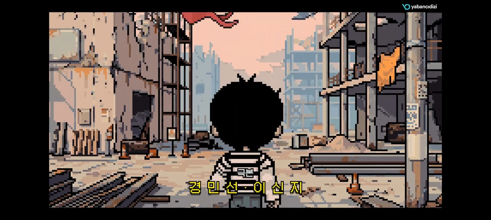

# Kırık Mühür RPG — 4 Görselden Çizim Referansı (19.11.2026)

> Kapsam: **yalnız Kırık Mühür RPG**. Arena Forge Pro ile karıştırma.
> **Durum:** Dört orijinal görsel **GitHub'a yüklendi ve doğrulandı**. Her dosya kaynak WebP verisi değiştirilmeden aktarıldı. Görsel commit: `83017d517310a3fc0f9660cc510918ca93ba0b4b`.

## Kaynak görseller (gönderim sırası)

1. `referanslar/kafe_sicak_isik.webp` — Kafe, pencere, masa, çay içen chibi karakter. Sıcak amber/somun tonları, turkuaz vurgu, iç mekânda 3–4 derinlik katmanı.
2. `referanslar/market_soguk_isik.webp` — Market rafları, küçük merkez karakter. Soğuk mavi/camgöbeği ışık, açık renk karolar, rafların perspektif çizgileri, koyu karakter konturları.
3. `referanslar/sehir_cephe.webp` — Eskimiş dükkân cepheleri. Kırık sıva, tabela/yüzey katmanları, gri-pembe-krem palet, yatay kaldırım.
4. `referanslar/yikik_sokak.webp` — Arkadan karakterli yıkık sokak. Şeftali gün batımı, ön planda koyu siluet, ara planda enkaz, uzakta düşük kontrastlı binalar.

## Görsel önizlemeleri

## Zorunlu görsel analiz ve üretim standardı

- **Tarz:** Bilinçli pikselli 2D/2.5D görünüm; düz fotoğraf filtresi değil. Koyu, tutarlı, basamaklı konturlar; kontrollü palet ve büyük renk adaları.
- **Doku:** Duvarlarda sıva/çatlak/kir, metalde mat kenar parlaması, camda soğuk yansıma, ahşapta sıcak renk kırılması; dekor birden çok ayrı pikselli renk bloğuyla çalışılsın.
- **Işık:** Kafede sıcak iç ışık ve soğuk pencere; markette soğuk üst ışık; sokakta yumuşak gündüz; yıkık sokakta sıcak gökyüzü ve soğuk gölgeler. Aydınlatma yönü sahne boyunca tutarlı.
- **Karakter:** Büyük baş, küçük gövde, sınırlı ama temiz yüz ifadesi; siyaha yakın dış kontur, açık/orta/koyu olmak üzere en az üç tonlu bölgesel gölgelendirme.
- **Derinlik:** Ön/orta/arka plan ayrı katmanlar; yakın nesnede güçlü kenar ve detay, uzakta düşük kontrast ve küçülen detay. Perspektif ve zemine basma noktaları uyumlu olsun.
- **Piksel tutarlılığı:** Sahne içinde karışık çözünürlükte rastgele piksel ölçüleri, bulanık interpolasyon, erimiş konturlar ve anti-alias çamurlaşması olmasın. Piksel ölçeği, hat kalınlığı ve ışık kırılmaları karşılaştırmalı denetlensin.
- **Kırık Mühür'e uyarlama:** Kendi dünya tasarımı, NPC'ler, kent dokusu ve görevleri; **dikey mobil ekran** için özgün kadrajlama. Referans görüntüleri oyun arka planı olarak doğrudan yapıştırma.
- **Telif/işaretler:** Kaynak ekran görüntülerindeki yabancidizi işareti, Korece altyazı, tabelalar ve özgün sahne/karakter kompozisyonları oyun varlığına taşınmasın. Görseller yalnız işçilik/teknik inceleme referansıdır.
- **Entegrasyon güvenliği:** Asıl `index.html` ve çalışan oyun mekanikleri değişmesin. Yeni çizimler önce ayrı testte incelensin; sonra görsel denetimden geçerek uygun ekranlara bağlansın.

## Kontrol listesi

- [x] Dört orijinal görsel dosyası `referanslar/` dizinine yüklenip GitHub içerik listesinde SHA ve boyutları doğrulandı.
- [ ] Her sahne için palet, kontur, perspektif, ışık ve piksel ölçeği örnekleri çıkarıldı.
- [ ] Kırık Mühür'e ait özgün dikey yerleşim eskizleri üretildi.
- [ ] Android'de sahne, sprite, NPC, savaş HUD ve menüyle görsel uyum kontrol edildi.
- [ ] Test edilmemiş bir değişiklik ana oyuna aktarılmadı.
